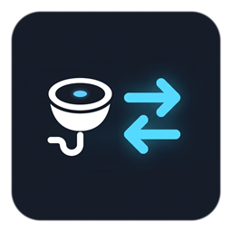

#  TinySink

Tiny Windows tray volume indicator & double-click audio output switcher in Rust.

[English](#english) · [Русский](#русский)

---

## English

- **Dynamic tray icon** — shows headphones or speakers, live volume (`0–100`), and **Mute** state; adapts to taskbar DPI and light/dark Windows themes.
- **Mouse controls**:
  - **Left-click** — compact volume flyout slider above the tray (with mute toggle and wheel support).
  - **Double-click** — cycle through checked playback devices.
  - **Scroll wheel** — adjust volume by `±2%` (auto-unmutes when scrolling up).
- **Context menu (right-click)** — quick device list, **Devices...** persistent checklist, **Device icon type** override (`Auto` / `Headphones` / `Speakers`), **Start with Windows**, Windows volume icon shortcut, and **Update** submenu (auto-check & one-click `SHA-256` verified updates).
- **Lightweight** — native Win32 + Core Audio API, event-driven with zero polling, single portable `.exe`.

---

## Русский

Минималистичный индикатор громкости для трея Windows и переключатель аудиоустройств по двойному клику на Rust.

- **Динамическая иконка в трее** — отображает наушники или колонки, громкость (`0–100`) и **Mute**; подстраивается под DPI панели задач и светлую/тёмную тему Windows.
- **Управление мышью**:
  - **ЛКМ** — компактный регулятор громкости над треем (ползунок, Mute и прокрутка).
  - **Двойной ЛКМ** — циклическое переключение отмеченных устройств вывода.
  - **Колёсико мыши** — изменение громкости с шагом `2%` (автоснятие Mute при увеличении).
- **Контекстное меню (ПКМ)** — быстрый выбор устройства, окно **Devices...** с чекбоксами, выбор типа иконки (**Device icon type**: `Auto` / `Headphones` / `Speakers`), **Start with Windows**, переход в настройки громкости Windows и подменю **Update** (автопроверка и обновление в один клик с проверкой `SHA-256`).
- **Минимальные ресурсы** — чистый Win32 + Core Audio API без фонового опроса, один портативный `.exe`.
